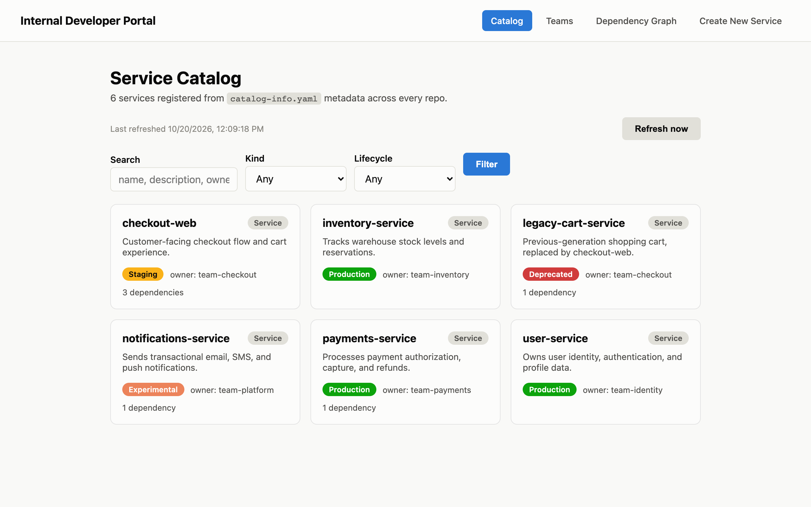
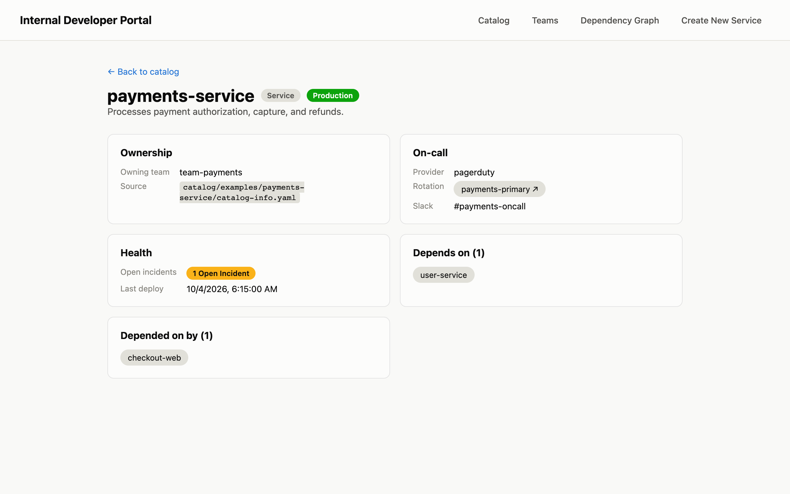
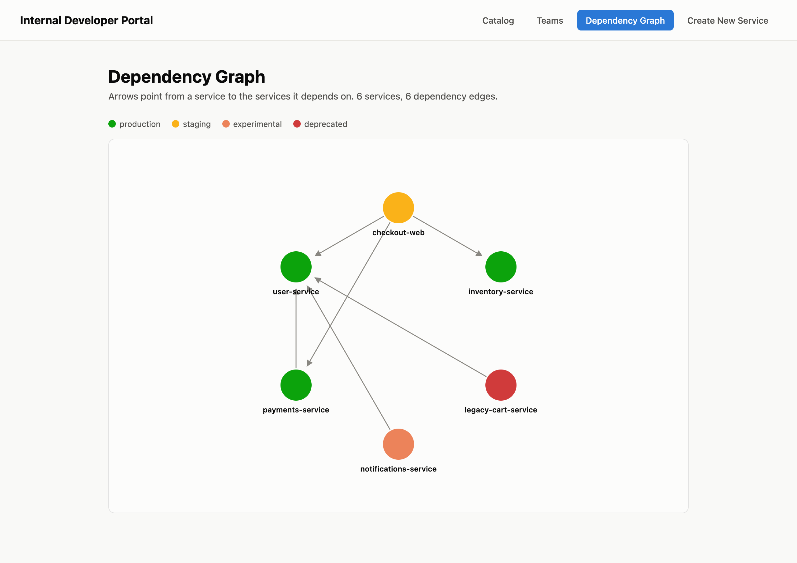
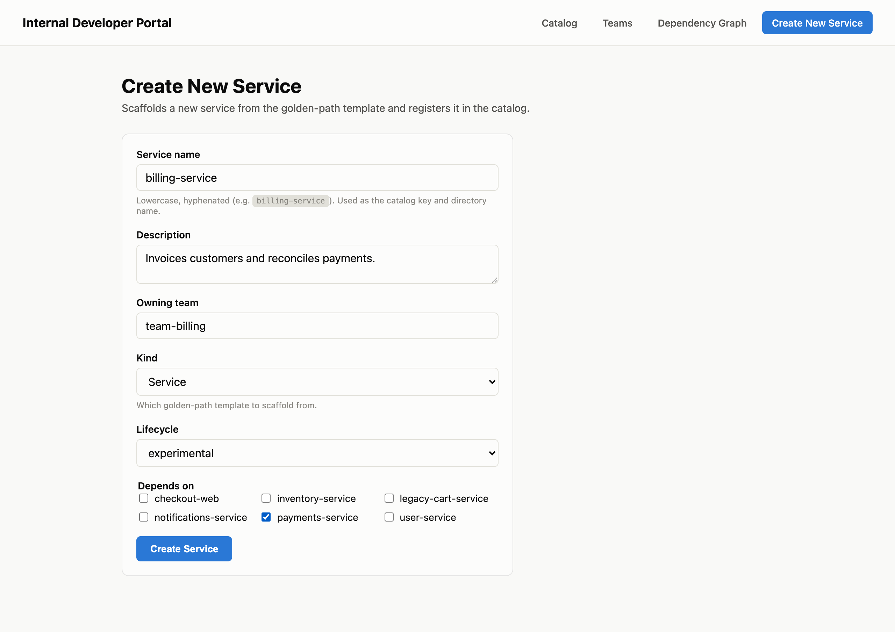
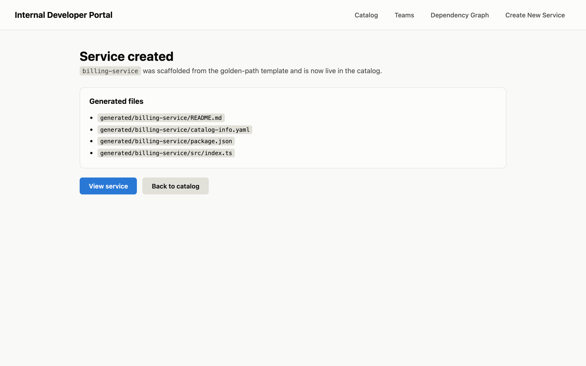
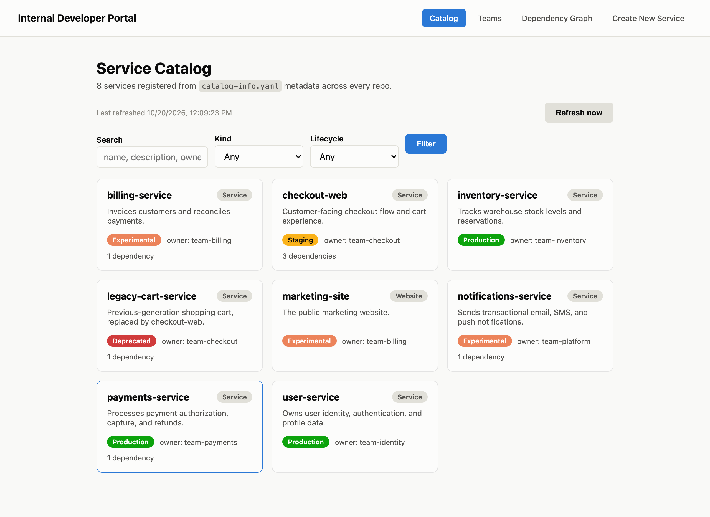
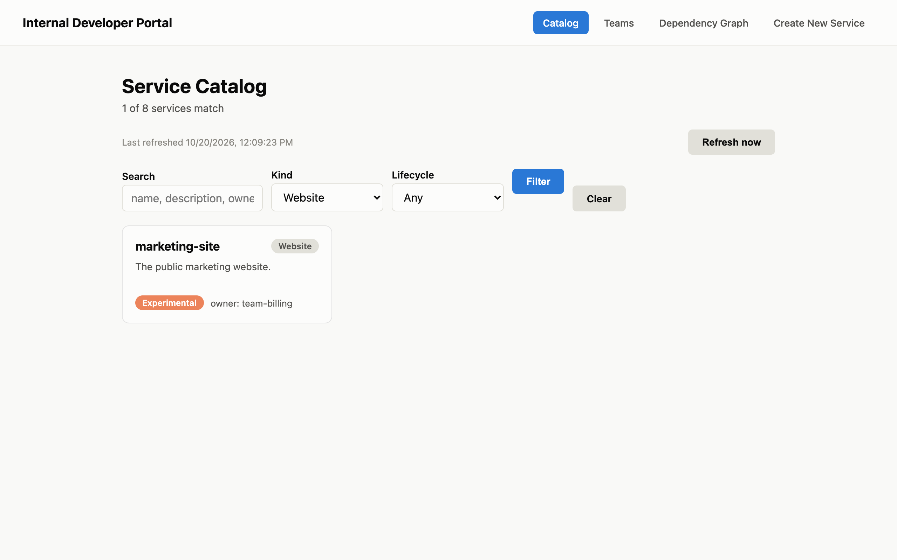
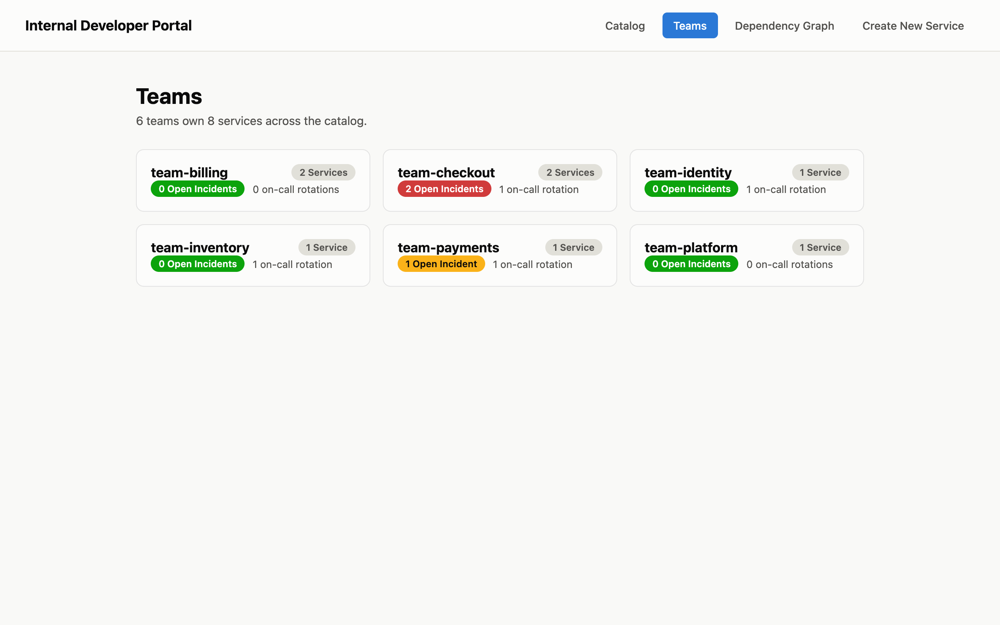
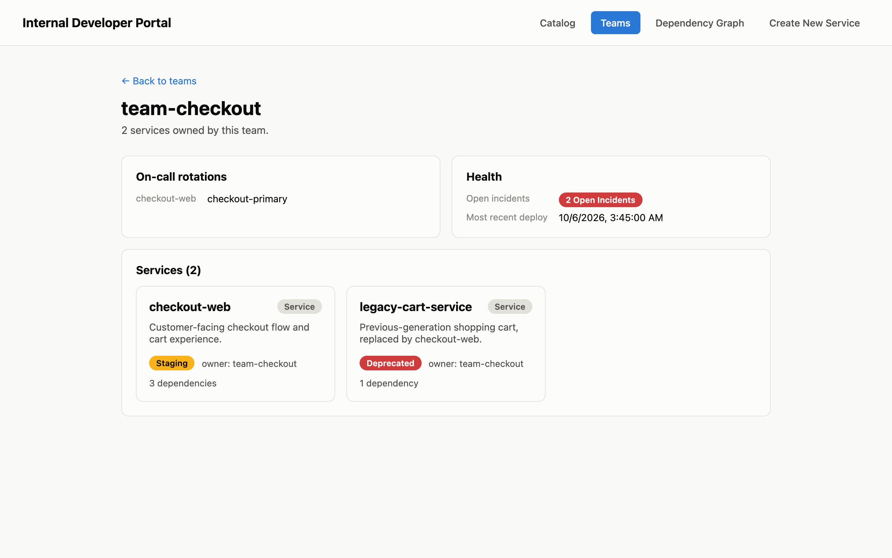
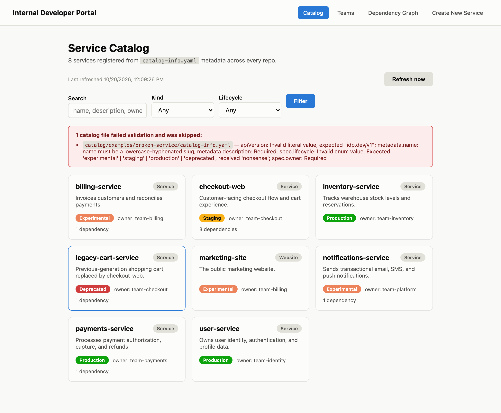

# internal-dev-portal

[](https://github.com/tenalisriharsha/internal-dev-portal/actions/workflows/ci.yml) [](LICENSE)

A lightweight, Backstage-style internal developer platform: a service catalog
built from `catalog-info.yaml` metadata in each repo, ownership and on-call
info, a dependency graph between services, and a self-service "create new
service" flow wired to a golden-path template.

## Preview

Every image is generated by [`scripts/capture`](scripts/capture), which starts the real portal from a scratch copy of
this repository, drives it with a real browser (including the self-service create form) and screenshots what it
renders. Nothing is mocked up by hand.

**Service catalog.** Every service registered from `catalog-info.yaml` metadata, with lifecycle and ownership at a glance:



**Service detail.** Ownership, the on-call rotation (a deep link into PagerDuty when `PAGERDUTY_SUBDOMAIN` is set),
a health panel, and both directions of the dependency relationship:



**Dependency graph.** The full service graph, nodes colored by lifecycle status, arrows pointing from a service to what
it depends on:



**Self-service create flow.** A form scaffolds a new service from the golden-path template, and the result lists the
files it generated:




**Golden paths, plural.** The Kind selector scaffolds a Service, Website or Library from its own template. The new
services are in the catalog immediately (an explicit refresh, no restart), and the list filters by search text, kind
and lifecycle through plain query parameters, so a filtered view is a shareable URL:




**Teams.** Every owner across the catalog, aggregated: service count, open incidents and on-call rotations. A team page
gathers its services and a health rollup:




**Validation errors.** A malformed `catalog-info.yaml` is skipped and reported in a banner instead of breaking the
catalog:



## Architecture

An npm-workspaces monorepo with two TypeScript packages:

- **`@idp/core`** — the domain layer: a Zod schema for `catalog-info.yaml`
  (metadata, ownership, lifecycle, on-call, and an optional `health` block —
  `lastDeployAt` and `openIncidents`), a `CatalogSource` abstraction (local
  directories and a GitHub-repos source, both implementing the same
  interface) feeding a validating catalog loader, a SQLite-backed
  `CatalogStore` that persists the last-loaded snapshot, a scheduler that
  refreshes the store on an interval, a dependency-graph builder with cycle
  detection, and a template engine that renders a golden-path scaffold
  (variable substitution only — no conditionals/loops yet, since no template
  has needed them).
- **`@idp/web`** — a server-rendered Express app (catalog list, service
  detail, team pages, dependency graph, create flow, and an `/admin/refresh`
  trigger) built on top of `@idp/core`. The create flow renders one of three
  golden-path templates (`templates/golden-path-service`,
  `-website`, `-library`) selected by a "Kind" field in the form — adding a
  template is adding a directory and a `templateDirs` entry, the rendering
  engine itself didn't change. Every page read is a SQLite read, not
  a re-fetch — the catalog only changes on an explicit refresh (scheduled,
  button-triggered, or after the create flow scaffolds a new service). Team
  pages (`/teams`, `/teams/:owner`) group services by `spec.owner` with no
  separate "team" entity — a team is just whatever string appears as an
  owner — and roll up each team's open incidents and on-call rotations.
  When `PAGERDUTY_SUBDOMAIN` or `OPSGENIE_ORG` is set, on-call rotation
  names render as links into that provider's schedule search instead of
  plain text. The catalog list supports `?q=`/`?kind=`/`?lifecycle=` query-
  param filtering over the already-loaded `CatalogEntry[]` — no new backend
  plumbing, just a filter over data the store already has. When `ADMIN_TOKEN`
  is set, `/create` and `POST /admin/refresh` are gated behind HTTP Basic
  auth (the token as the password, any username); unset, every route stays
  open, matching pre-Phase-5 behavior for a localhost demo.

A GitHub Actions workflow (`.github/workflows/ci.yml`) runs `npm run lint`
(a root `tsc --build` across both packages via TypeScript project references)
and the full test suite on every push and pull request.

Full details, including the source/store abstraction boundary, are in
[PROGRESS.md](PROGRESS.md).

## Getting started

```sh
npm install
npx tsc --build packages/core   # @idp/web imports the compiled @idp/core
npm run dev --workspace=@idp/web
```

Then open `http://localhost:3000`. On startup the server does an initial
catalog refresh and then re-refreshes every 5 minutes by default; both
local-directory and (if configured) GitHub sources are read, validated, and
persisted to a `catalog.db` SQLite file at the repo root.

Optional environment variables:

```sh
PORT=3000                              # server port
CATALOG_REFRESH_INTERVAL_MS=300000     # scheduled refresh interval; 0 disables it
CATALOG_GITHUB_REPOS=acme/widgets,acme/sprockets@main   # owner/repo[@ref], comma-separated
GITHUB_TOKEN=ghp_...                   # only needed for private repos / higher rate limits
PAGERDUTY_SUBDOMAIN=acme               # turns pagerduty rotations into schedule-search links
OPSGENIE_ORG=acme                      # turns opsgenie rotations into schedule-search links
ADMIN_TOKEN=some-shared-secret         # when set, gates /create and POST /admin/refresh behind Basic auth
```

## Running tests

```sh
npm test
```

Runs the full suite for both packages: catalog/schema/source/store/scheduler/
graph/template unit tests in `@idp/core`, and route-level integration tests
(including the full create-service flow, the explicit refresh route, team
pages, on-call escalation links, catalog search/filter, and the admin-token
gate) in `@idp/web`. The GitHub source is tested with an injected fetch
function, so the suite never makes a real network call.

```sh
npm run lint   # tsc --build across both packages, via root tsconfig.json project references
```

## Repository layout

```
.github/workflows/ci.yml  lint + test on every push/PR
packages/core/            catalog schema, sources, SQLite store, scheduler, dependency graph, template engine
packages/web/             Express app: catalog UI, service detail, graph, create flow, admin refresh, auth
catalog/examples/         example catalog-info.yaml fixtures (stand-ins for "other repos")
templates/golden-path-service/   golden path for kind: Service
templates/golden-path-website/   golden path for kind: Website
templates/golden-path-library/   golden path for kind: Library
generated/                where self-service "create new service" writes new services
docs/screenshots/         screenshots used in this README (generated by scripts/capture)
tsconfig.json              root project-reference config, used by `npm run lint`
catalog.db                 (gitignored) persisted catalog snapshot, created on first run
```

## Status

Complete at version 0.1. The phase-by-phase build history is in [PROGRESS.md](PROGRESS.md) and known limitations and ideas for next steps are in [DAILY_REPORT.md](DAILY_REPORT.md).

## License

[MIT](LICENSE)
